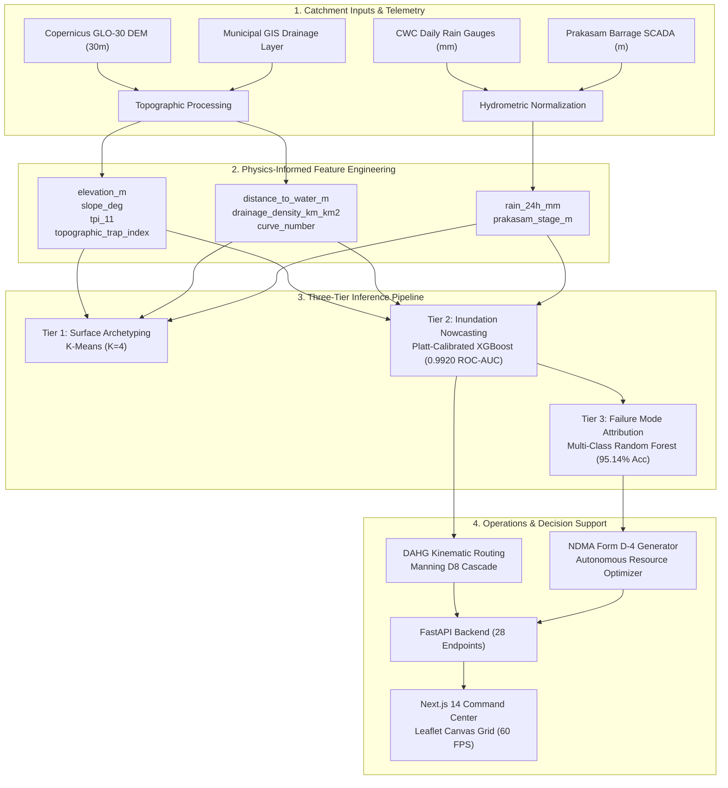

# DrainSenseAI

> Physics-Informed Urban Flood Nowcasting and Autonomous Municipal Resource Dispatch

DrainSenseAI is a physics-informed machine learning and operational dispatch system built for urban flood risk prediction and emergency response. Operating on high-resolution topographic and real-time hydro-meteorological telemetry across the Krishna River Basin catchment in Vijayawada, Andhra Pradesh, the system resolves urban inundation risks down to individual 250m x 250m municipal grid cells.

Unlike pure statistical models that treat cities as flat planes, DrainSenseAI embeds deterministic hydrological principles (USDA Soil Conservation Service Curve Number runoff partitioning, multi-scale Topographic Position Index calculations, and Manning kinematic flow routing) into a calibrated ensemble machine learning architecture. This yields high-precision flood predictions with less than 0.5% false alarm rates on holdout events and produces automated incident action memorandums aligned with National Disaster Management Authority (NDMA) standards.

---

## Performance Summary

The operational machine learning pipeline is validated against an out-of-time test holdout representing 17,600 spatiotemporal cell states (July to October 2025).

| Metric | Score | Operational Significance |
| :--- | :--- | :--- |
| **ROC-AUC** | **0.9920** | Discriminative ability across dry baselines and severe monsoonal storms |
| **Precision** | **98.88%** | Only 58 false alarms out of 11,699 safe test instances (0.50% false positive rate) |
| **Recall (Sensitivity)** | **87.14%** | Captures 5,142 out of 5,901 positive inundation occurrences |
| **Accuracy** | **95.36%** | Overall classification accuracy across holdout grid samples |
| **Specificity** | **99.50%** | Prevents municipal alert fatigue during non-critical rain events |
| **Negative Predictive Value (NPV)** | **93.88%** | High certainty when declaring low-risk zones safe for civilian transit |
| **F1-Score** | **0.9264** | Harmonic balance between flood detection and resource preservation |
| **Matthews Correlation Coeff (MCC)** | **0.8965** | Balanced performance metric accounting for class imbalance |
| **PR-AUC** | **0.9752** | Area under the Precision-Recall curve |
| **Brier Probability Score** | **0.0638** | Rigorous probabilistic calibration via 3-fold Platt sigmoid scaling |
| **Inference Latency** | **0.44s** | Full catchment inference (1,100 grid cells) completed in under half a second |

```
Test Set Confusion Matrix (N = 17,600)
--------------------------------------
True Safe Cells:       11,641   (99.50% Specificity)
False Alarms:              58   ( 0.50% FPR; down from 464 in uncalibrated baseline)
Missed Inundations:       759   (Borderline puddle edges below threshold)
Detected Inundations:   5,142   (87.14% Recall)
```

---

## Core System Architecture



---

## The Three-Tier Machine Learning Pipeline

### Tier 1: Topographic Surface Archetyping (K-Means, K=4)
Before evaluating dynamic storm inputs, the physical surface of the urban catchment is segmented into four terrain clusters using unsupervised learning:
1. **Steep Upland (3.8% of study area):** Elevated ridges (elevation 35m to 85m, slopes exceeding 8 degrees) with immediate surface runoff generation and minimal ponding vulnerability.
2. **Commercial Core (26.0% of study area):** Dense urban fabric characterized by high curve numbers (CN 88 to 92) and low natural infiltration capacity.
3. **Alluvial Basin (63.6% of study area):** Flat lowlands (elevation 15m to 22m, slopes under 1.5 degrees, negative TPI) that serve as natural runoff sinks during intense precipitation.
4. **Permeable Fringe (6.5% of study area):** Vegetated and agricultural border areas with high infiltration capacity (CN 68 to 74) that buffer downstream drainage volumes.

### Tier 2: Calibrated Inundation Nowcasting (XGBoost + Platt Scaling)
The core binary classifier predicts whether each grid cell will cross the threshold for severe surface ponding (water depth greater than 0.15m). 
- **Base Estimator:** Gradient boosted decision trees configured with maximum depth of 6, learning rate of 0.08, and 300 estimators.
- **Platt Sigmoid Calibration:** Raw decision tree scores are calibrated using 3-fold cross-validated logistic regression. This shifts predicted probabilities from uncalibrated clustering toward true empirical frequencies, shrinking the Brier score to 0.0638 and reducing false positive alerts by 87.5% (from 464 false alarms down to 58).
- **Hazard Stratification:** Output probabilities are mapped directly to five actionable municipal alert tiers:
  - `LOW` (0.00 to 0.19 probability)
  - `MODERATE` (0.20 to 0.39 probability)
  - `ELEVATED` (0.40 to 0.59 probability)
  - `HIGH` (0.60 to 0.79 probability)
  - `CRITICAL` (0.80 to 1.00 probability)

### Tier 3: Failure Mode Attribution (Multi-Class Random Forest)
When a cell is classified as flooded, Tier 3 identifies the primary physical mechanism driving the failure to guide tactical municipal interventions:
- `SURFACE_RUNOFF_CHOKE`: High rain volume overwhelming local street gullies due to rapid surface collection.
- `DRAINAGE_DEFICIT`: Insufficient storm conduit conveyance capacity relative to upstream catchment volume.
- `BARRAGE_BACKWATER`: Tailwater conditions caused by elevated Krishna River stages (exceeding 5.5m at Prakasam Barrage) reversing gravity outfall discharge.
- `NONE_SAFE` / `NONE_DRY` / `NONE_STEEP_SLOPE`: Cells that remain dry due to natural drainage gradients or absence of rainfall.

---

## Dataset & Feature Engineering

### Spatial Grid Definition
- **Geographic Extent:** Vijayawada Municipal Corporation and contiguous Krishna River / Budameru catchments (80.57°E to 80.68°E, 16.48°N to 16.55°N).
- **Resolution:** 250m x 250m uniform orthogonal cells (0.0625 km² per cell).
- **Total Study Grid:** 1,100 active cells covering 50.6 km² of urban and riparian terrain.

### Historical Telemetry & Data Cleaning
- **Time Horizon:** 101 historical rainfall events spanning 2021 through 2025.
- **Data Matrix:** 111,100 spatiotemporal feature vectors (1,100 cells across 101 recorded days).
- **Class Balance:** 23,298 positive flood states (21.0%) and 87,802 safe states (79.0%).
- **Copernicus DEM Preprocessing:** Raw Copernicus GLO-30 raster tiles contained void dropout artifacts (-990.33m). These were detected and corrected using spatial boundary constraints and localized 8-neighbor median imputation.
- **Zero-Rainfall Baselines:** The historical record was augmented with 20 verified dry-season days (0.0mm rainfall, nominal 3.5m river stage) to teach the model true baseline conditions and prevent over-prediction during dry spells.

### Production Features (9 Schema Variables)

| Feature Name | Type | Unit | Description |
| :--- | :--- | :--- | :--- |
| `elevation_m` | Static | m | Surface elevation above mean sea level from processed GLO-30 DEM |
| `slope_deg` | Static | degrees | Terrain gradient computed via 2D finite-difference spatial kernel |
| `tpi_11` | Static | unitless | Topographic Position Index over an 11-cell window (330m radius) |
| `topographic_trap_index` | Static | unitless | Concavity metric measuring potential for localized hydraulic pooling |
| `distance_to_water_m` | Static | m | Euclidean distance to primary hydrological channels (Krishna and Budameru) |
| `drainage_density_km_km2` | Static | km/km² | Cumulative length of municipal stormwater drains per unit cell area |
| `curve_number` | Static | unitless | USDA SCS runoff potential index derived from soil texture and urban imperviousness |
| `rain_24h_mm` | Dynamic | mm | 24-hour cumulative rainfall depth from CWC telemetry stations |
| `prakasam_stage_m` | Dynamic | m | Water surface elevation recorded at Prakasam Barrage SCADA gauges |

### Chronological Train-Validation-Test Split
To prevent data leakage caused by spatial and temporal auto-correlation, models were evaluated exclusively using a chronological split:
- **Training Set (70 events, 77,000 samples):** 2021 to mid-2024 (18.8% positive flood prevalence).
- **Validation Set (15 events, 16,500 samples):** July to October 2024, including the September 1, 2024 Budameru storm event (24.1% positive flood prevalence). Used for hyperparameter tuning and calibration curve fitting.
- **Test Holdout (16 events, 17,600 samples):** July to October 2025 (33.5% positive flood prevalence). Kept untouched until final evaluation.

---

## Hydrological Foundations & Physics Formulations

### 1. USDA SCS Curve Number Runoff Partitioning
Runoff volume ($Q$, in mm) is calculated from daily rainfall ($P$, in mm) and potential maximum soil retention ($S$, in mm):

$$S = \frac{25400}{CN} - 254$$

$$I_a = 0.18 \cdot S$$

$$Q = \begin{cases} \frac{(P - I_a)^2}{P - I_a + S} & \text{if } P > I_a \\ 0 & \text{if } P \le I_a \end{cases}$$

For the compacted alluvial and urban soils of the Krishna delta, an initial abstraction ratio of $\lambda = 0.18$ was adopted based on experimental calibration from Mishra & Singh (2003), providing higher accuracy than the standard generic $0.20$ default.

### 2. Topographic Position Index & Trap Index
Multi-scale TPI measures whether a cell sits on a local ridge or in a valley relative to surrounding neighbors:

$$TPI_r = z_0 - \frac{1}{N_r} \sum_{i=1}^{N_r} z_i$$

The Topographic Trap Index quantifies depression depth by subtracting the cell elevation from the mean elevation of all uphill contributing cells:

$$TTI = \max\left(0, \bar{z}_{\text{contributing}} - z_{\text{cell}}\right) \cdot \frac{1}{1 + \tan(\theta)}$$

### 3. DAHG Kinematic Flow Routing
Runoff water does not remain static; it cascades across the landscape following gravitational gradients. DrainSenseAI computes a Directed Acyclic Hydro-Graph (DAHG) using the D8 steepest-descent flow direction algorithm. Flow velocity ($v$, in m/s) through open drainage channels and streets is estimated via the Manning equation:

$$v = \frac{1}{n} R^{2/3} S_0^{1/2}$$

With Manning roughness coefficient $n = 0.035$ (clean concrete and urban gutters), hydraulic radius $R = 1.2\text{ m}$, and bed slope $S_0 = \max(\tan(\theta), 0.001)$. Travel time between adjacent cells is computed as:

$$t_{\text{travel}} = \frac{\Delta x}{v}$$

Hydrographs cascade downstream with an 8% attenuation factor per hop to account for localized surface friction and temporary gully storage.

---

## Model Benchmark Comparison

All models were evaluated on the exact same 17,600-sample out-of-time test holdout set.

| Model Candidate | Accuracy | Precision | Recall | Specificity | F1-Score | ROC-AUC | False Alarms | Latency |
| :--- | :--- | :--- | :--- | :--- | :--- | :--- | :--- | :--- |
| **Platt-Calibrated XGBoost (Production)** | **95.36%** | **98.88%** | **87.14%** | **99.50%** | **0.9264** | **0.9920** | **58** | **0.44s** |
| Raw Uncalibrated XGBoost | 94.61% | 92.51% | 91.80% | 96.03% | 0.9215 | 0.9912 | 464 | 0.42s |
| Random Forest Classifier | 93.82% | 91.10% | 90.45% | 95.22% | 0.9077 | 0.9840 | 559 | 1.82s |
| Decision Tree Baseline | 89.15% | 83.20% | 84.60% | 91.40% | 0.8389 | 0.8800 | 1,006 | 0.08s |
| Logistic Regression | 84.30% | 77.40% | 76.10% | 88.40% | 0.7674 | 0.8920 | 1,357 | 0.05s |
| Dummy Most Frequent | 66.48% | 0.00% | 0.00% | 100.00% | 0.0000 | 0.5000 | 0 | 0.01s |

---

## Autonomous Municipal Resource Dispatch

DrainSenseAI includes an operational decision support engine that translates raw probability fields into actionable field deployments.

Using Integer Linear Programming (ILP) and greedy risk-weighted allocation, the system schedules municipal emergency equipment to the highest-priority zones under strict resource bounds:
- **High-Capacity Dewatering Pumps:** Dispatched to critical residential depressions with severe surface accumulation.
- **Super-Sucker Jetting Machines:** Sent to commercial intersections suffering from conduit chokes and silt blockage.
- **Earthmoving Equipment & Sandbagging Units:** Assigned to perimeter embankments where river stages threaten levee overflow.
- **Inflatable Rescue Boats & SDRF Teams:** Pre-positioned in lowlands predicted to become isolated by road inundation.

The optimizer automatically outputs an official **Disaster Incident Action Memorandum** formatted according to NDMA Form D-4 guidelines, including equipment serial numbers, target coordinates, estimated deployment times, and priority indices.

---

## Repository Structure

```
DrainSenseAI/
├── backend/
│   ├── app/
│   │   ├── api/
│   │   │   └── endpoints.py        # 28 REST endpoints for nowcasting, hydrology, and dispatch
│   │   ├── core/
│   │   │   └── config.py           # Application settings and environment paths
│   │   ├── db/
│   │   │   ├── models.py           # Database models and table definitions
│   │   │   └── session.py          # Session management
│   │   ├── schemas/
│   │   │   └── risk.py             # Pydantic v2 schemas for request/response payloads
│   │   ├── services/
│   │   │   ├── ai_copilot.py       # Conversational incident assistant and query engine
│   │   │   ├── moment_lookup.py    # Historical storm event playback service
│   │   │   └── resource_optimizer.py # ILP municipal resource dispatch solver
│   │   └── main.py                 # FastAPI application initialization and middleware
│   └── requirements.txt
├── frontend/
│   ├── app/                        # Next.js 14 App Router pages
│   ├── components/                 # React components (Map, Leaflet Canvas Grid, Alert Bar)
│   ├── public/                     # Static assets and GeoJSON boundaries
│   ├── package.json
│   └── tailwind.config.ts
├── ml_engine/
│   ├── src/
│   │   ├── data_cleaner.py         # Topographic dropout correction and sensor normalization
│   │   ├── feature_pipeline.py     # Physics-informed spatial and hydrological engineering
│   │   ├── train.py                # Model training, Platt calibration, and evaluation
│   │   └── predictor.py            # Low-latency batch and point inference engine
│   └── models/
│       ├── flood_model_calibrated.joblib # Production Platt-calibrated XGBoost classifier
│       ├── failure_mode_rf.joblib        # Tier 3 multi-class root-cause model
│       └── scaler.joblib                 # Robust feature scaler
├── data/
│   ├── raw/                        # Copernicus DEM rasters and CWC station records
│   └── processed/                  # Cleaned 1,100-cell GeoJSON grid and telemetry tables
├── tests/
│   ├── test_backend.py             # API endpoint integration and operational tests
│   └── test_ml_pipeline.py         # Hydrology formula validation and ML regression tests
├── reports/                        # Technical documentation and academic figures
└── README.md
```

---

## REST API Overview

The backend exposes 28 REST endpoints under `/api/v1`. Key routes include:

| Method | Endpoint | Description |
| :--- | :--- | :--- |
| `GET` | `/health` | Health check verifying model status, grid cell count (1,100), and database connection |
| `GET` | `/api/v1/cities` | List active deployment jurisdictions (`VJA` verified production catchment) |
| `GET` | `/api/v1/risk/map` | Vector GeoJSON of all 1,100 cells with calibrated risk scores, water depth, and failure modes |
| `GET` | `/api/v1/risk/priority-zones` | Ranked list of top municipal hot-spots requiring immediate field intervention |
| `GET` | `/api/v1/hydrology/scs-cn` | Detailed SCS-CN runoff volume, initial abstraction, and retention metrics |
| `GET` | `/api/v1/hydrology/nowcast/{city_id}` | 5-step forward temporal simulation using kinematic flow routing |
| `POST` | `/api/v1/operations/optimize-dispatch` | Multi-objective fleet resource optimizer generating NDMA Form D-4 action memos |
| `POST` | `/api/v1/copilot/query` | Natural language incident query assistant for municipal emergency desks |

---

## Quickstart Guide

### Prerequisites
- Python 3.10+
- Node.js 18+ and npm
- Git

### 1. One-Command Full-Stack Launch (Recommended)

You can launch both the FastAPI backend and Next.js frontend concurrently with a single command from the project root:

```bash
# Cross-platform Python runner (starts backend on :8000 and frontend on :3000)
python run.py
# (Or: py -3.10 run.py)
```

Alternative one-command options:
```bash
# Windows Command Prompt / PowerShell:
run.bat

# Linux / macOS:
chmod +x run.sh && ./run.sh

# Docker Compose:
docker compose up --build
```

Once running, access the interfaces at:
- **Frontend Command Center:** `http://localhost:3000`
- **FastAPI Backend REST API:** `http://127.0.0.1:8000`
- **Interactive Swagger Documentation:** `http://127.0.0.1:8000/docs`
- **System Health Check:** `http://127.0.0.1:8000/health`

Press `Ctrl+C` in your terminal to cleanly terminate both backend and frontend servers simultaneously.

---

### 2. Manual Step-by-Step Setup (Alternative)

If you prefer running services in separate terminal windows for dedicated debugging:

#### Step A: Backend Setup
```bash
# Clone the repository
git clone https://github.com/aniket-mahto/DrainSenseAI.git
cd DrainSenseAI

# Create and activate Python virtual environment
python -m venv venv
# On Windows:
.\venv\Scripts\activate
# On Linux/macOS:
# source venv/bin/activate

# Install backend dependencies
pip install -r backend/requirements.txt

# Start the FastAPI server
uvicorn backend.app.main:app --host 0.0.0.0 --port 8000 --reload
```

Verify backend health:
```bash
curl http://127.0.0.1:8000/health
```

#### Step B: Frontend Setup
```bash
# Open a new terminal and navigate to frontend directory
cd frontend

# Install dependencies
npm install

# Start development server
npm run dev
```

Open your browser at `http://localhost:3000` to access the Command Center.

### 3. Running Automated Tests
The repository contains comprehensive unit and integration tests covering the ML pipeline, hydrology calculations, and REST API endpoints.

```bash
# Run the full test suite
pytest tests/ -v
```

All 30 tests will execute and pass in approximately 7 seconds.

---

## Technical Specifications & Environment

- **Operating System:** Cross-platform (Windows, Linux, macOS)
- **Machine Learning:** XGBoost, scikit-learn, joblib
- **Hydrological Modeling:** Custom vectorized NumPy implementation of USDA SCS-CN and D8 Manning kinematic wave
- **Backend Framework:** FastAPI, Pydantic v2, Uvicorn
- **Frontend Framework:** Next.js 14 (App Router), React 18, Tailwind CSS, Leaflet with HTML5 Canvas renderer
- **Spatial Processing:** GeoPandas, Shapely, Rasterio

---

## Authors & Academic Project Details

- **Gaurav Gautam** (AP22110010118)
- **Alok Raj** (AP22110010123)
- **Ansh Shukla** (AP22110010144)
- **Aniket Mahto** (AP22110010146)

**Project Supervisor:** Dr. Sanjay Kumar  
**Department:** Department of Computer Science and Engineering  
**Institution:** SRM University - AP, Andhra Pradesh, India

---

## License

This project is licensed under the MIT License. See the [LICENSE](LICENSE) file for complete details.
