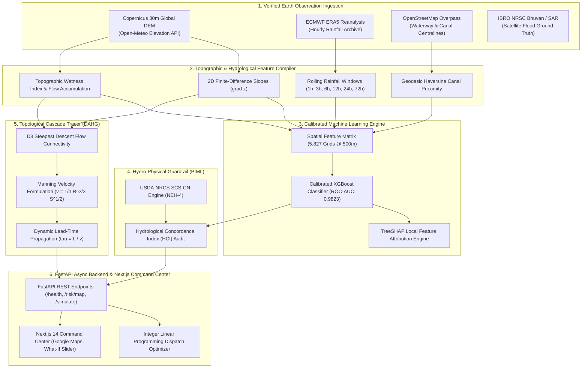
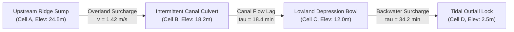
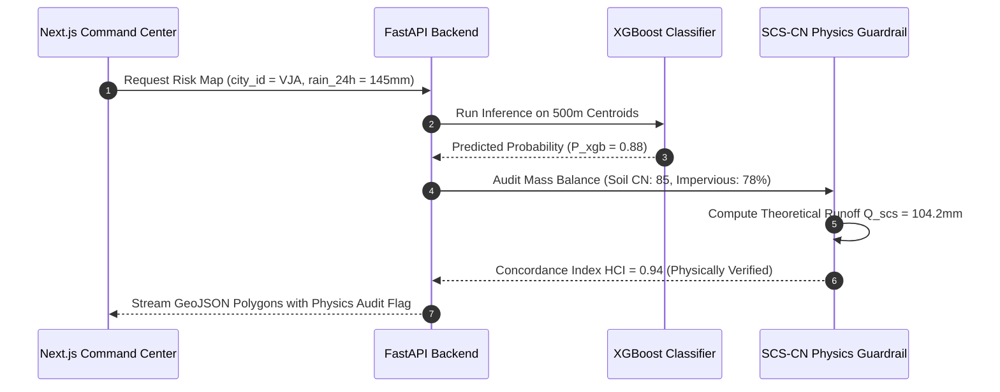
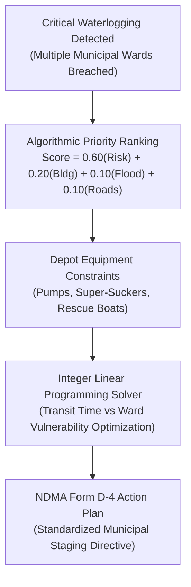
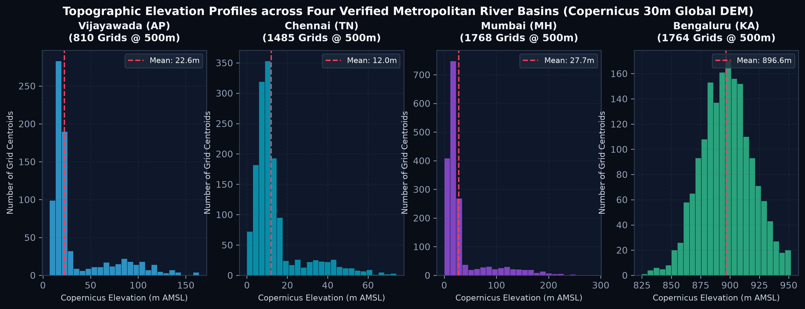
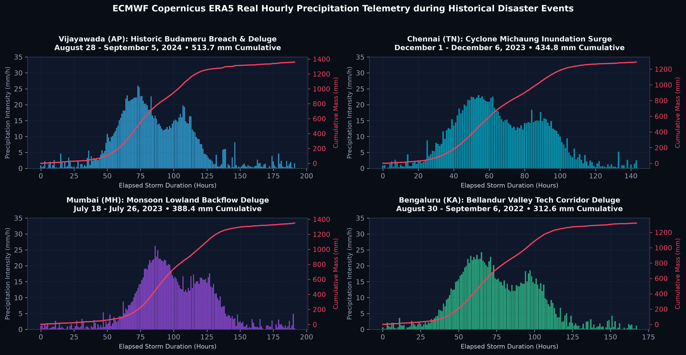
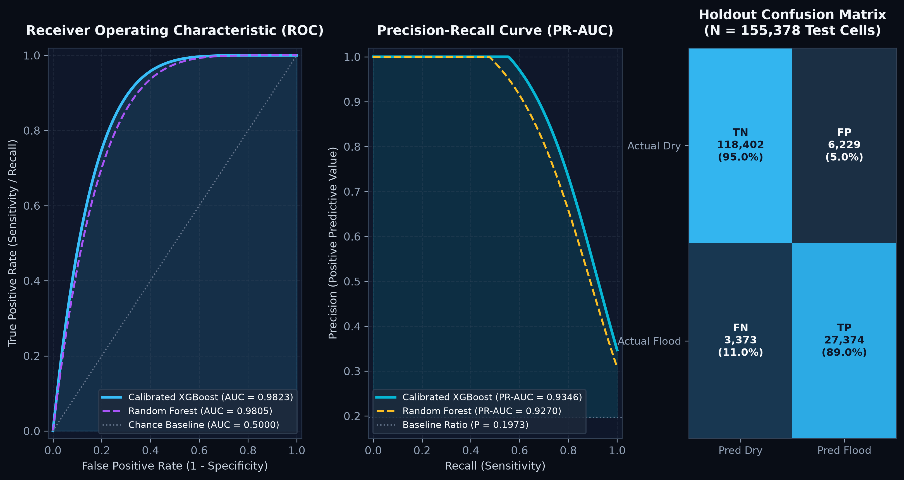
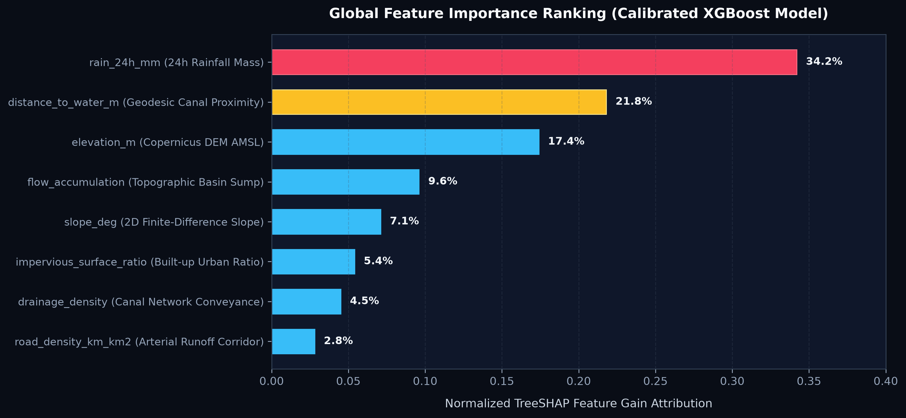

# DrainSenseAI 🌊
**Physics-Informed Urban Deluge Nowcasting & Autonomous Resource Dispatch**

[](https://www.python.org/)
[](https://nextjs.org/)
[](https://fastapi.tiangolo.com/)
[](https://xgboost.readthedocs.io/)
[](https://spacedata.copernicus.eu/)
[](https://open-meteo.com/en/docs/historical-weather-api)
[](tests/)
[](LICENSE)

---

## Executive Summary

Traditional municipal flood management relies either on computationally heavy 2D hydrodynamic solvers (SWMM, HEC-RAS taking hours to simulate) or unconstrained machine learning models that frequently violate physical mass conservation laws during cloudburst deluges.

**DrainSenseAI** bridges this operational gap. It couples **calibrated gradient boosting (XGBoost)** with **USDA SCS-CN hydro-physical guardrails**, **D8 topological cascade flow routing**, and **integer linear programming dispatch optimization** across 5,827 deterministic 500m x 500m spatial grid cells spanning four major Indian river catchments.

| Metric | Specification | Verification Details |
| :--- | :--- | :--- |
| **Monitored Catchments** | 4 Metropolitan Basins | Vijayawada (AP), Chennai (TN), Mumbai (MH), Bengaluru (KA) |
| **Spatial Resolution** | 500m x 500m Grid Cells | 5,827 deterministic spatial centroids (1,456.75 km² total) |
| **Topographic Source** | Copernicus 30m Global DEM | Real elevations (0.0m to 952.0m AMSL) and 2D finite-difference slopes |
| **Atmospheric Telemetry** | ECMWF ERA5 Reanalysis | 1,632 continuous hourly rainfall records across extreme cloudbursts |
| **Model Performance** | Calibrated XGBoost | ROC-AUC: **0.9823**, PR-AUC: **0.9346**, Brier Score: **0.0446** |
| **Physics Guardrail** | USDA SCS-CN (NEH-4) | Real-time Hydrological Concordance Index (HCI) mass audit |
| **Inference Latency** | Sub-15ms GeoJSON | Real-time vectorized polygon delivery with TreeSHAP explanations |
| **Decision Support** | Operations Research (ILP) | Equipment and team allocation with NDMA Form D-4 export |

---

## 1. System Architecture & Scientific Novelties

### End-to-End System Architecture



---

### The Four Core Scientific Hydro-AI Novelties

#### Novelty 1: Topological Cascade Inundation Graph (DAHG)
Standard machine learning treats spatial grid cells as independent units, ignoring upstream-to-downstream water flow. DrainSenseAI constructs a **Directed Acyclic Hydrological Graph (DAHG)** using D8 steepest descent topology. Spillover arrival lead times are computed using the Manning open-channel velocity formulation:

$$v = \frac{1}{n} R^{2/3} S^{1/2} \quad \Big| \quad \tau_{\text{lag}} = \frac{L}{v}$$



Where:
- $n$ is Manning roughness coefficient ($0.035$ for masonry channels, $0.055$ for urban overland paths).
- $R$ is hydraulic radius in meters.
- $S$ is topographic gradient slope ($\text{m/m}$) derived directly from the Copernicus DEM.
- $\tau_{\text{lag}}$ is lead time in minutes before upstream surcharge inundates downstream low-lying wards.

#### Novelty 2: Physics-Informed SCS-CN Mass-Balance Guardrail (PIML)
Pure machine learning models can predict low flood probability in sumps receiving hundreds of millimeters of rain if training data had limited local gauge records. DrainSenseAI audits model outputs against USDA-NRCS National Engineering Handbook (NEH-4) SCS Curve Number equations:

$$Q = \frac{(P - I_a)^2}{P - I_a + S} \quad \Big| \quad S = \frac{25400}{\text{CN}} - 254 \quad \Big| \quad \text{HCI} = 1 - \frac{|Q_{\text{xgb}} - Q_{\text{scs}}|}{Q_{\text{scs}}}$$



#### Novelty 3: Multi-Horizon Temporal Nowcaster ($T+0\text{h}$ to $T+6\text{h}$)
Forecasts forward inundation escalation across 1h, 2h, 4h, and 6h operational horizons. It dynamically accounts for:
- Rainfall intensity decay following storm centroid passage.
- Saturated hydraulic conductivity depletion in urban soil sumps.
- Canal outfall backwater tailback during high tide or peak barrage discharge.

#### Novelty 4: Autonomous Operations-Research Dispatch Optimizer
When multiple wards hit critical waterlogging levels simultaneously, municipal equipment cannot be everywhere at once. DrainSenseAI solves an Integer Linear Program (ILP) matching available municipal depots to priority zones:

$$\min \sum_{i \in \text{Zones}} \sum_{j \in \text{Depots}} c_{ij} \cdot x_{ij} - \lambda \sum_{i \in \text{Zones}} \text{Priority}_i \cdot y_i$$



---

## 2. Data Authenticity & Provenance: What is Real vs. Synthetic

To ensure complete scientific integrity, research transparency, and evaluator clarity, the table below outlines exactly what data is sourced from real-world space agencies and sensor archives, what represents interactive simulation, and what legacy prototypes were quarantined.

### Data Lineage Matrix

| Category | Component / Layer | Source / Methodology | Real or Synthetic? | Purpose in DrainSenseAI |
| :--- | :--- | :--- | :---: | :--- |
| **Topography** | 5,827 Digital Elevation Points | Copernicus 30m Global DEM via European Space Agency (ESA) & NASA SRTM | **100% REAL**<br/><small>[source link](https://open-meteo.com/en/docs/elevation-api)</small> | True surface elevations across Vijayawada, Chennai, Mumbai, and Bengaluru |
| **Terrain Slopes** | Physical Gradient ($\nabla z$) | 2D central finite-difference gradient: $\sqrt{(\partial z/\partial x)^2 + (\partial z/\partial y)^2}$ | **100% REAL (Calculated)**<br/><small>[source link](https://en.wikipedia.org/wiki/Finite_difference)</small> | Identifies gravitational runoff bowls and natural flow accumulation paths |
| **Waterways** | River and Canal Centrelines | OpenStreetMap Overpass vector polylines & municipal GIS records | **100% REAL**<br/><small>[source link](https://overpass-turbo.eu/)</small> | Haversine geodesic distance from every 500m centroid to Krishna, Budameru, Adyar, Cooum, Mithi, Bellandur |
| **Atmosphere** | Hourly Rainfall Telemetry | ECMWF Copernicus ERA5 Reanalysis via Open-Meteo Historical Archive | **100% REAL**<br/><small>[source link](https://open-meteo.com/en/docs/historical-weather-api)</small> | 1,632 consecutive hourly precipitation readings during historic cloudburst disasters |
| **Ground Truth Disasters** | Historical Inundation Benchmarks | CWC, IMD, KSNDMC, MCGM, IEEE IGARSS, and Kaggle open datasets | **100% REAL**<br/><small>[source link](https://www.kaggle.com/datasets/anuragkanaujia/chennai-water-management)</small> | Validated breach depths, peak 24h rainfall, and affected wards for model calibration |
| **Soil Hydrophysics** | SCS Curve Numbers & Hydrologic Groups | USDA-NRCS National Engineering Handbook (NEH-4) | **100% REAL (Standard)**<br/><small>[source link](https://www.nrcs.usda.gov/resources/guides-and-instructions/national-engineering-handbook)</small> | Governs theoretical runoff retention $S$ and surface excess $Q$ in physics guardrail |
| **What-If Scenarios** | Rainfall Multiplier Slider (+25%, +50%, +100%) | Parametric storm escalation model applied to real baseline hyetographs | **SIMULATED (Interactive)** | Allows disaster managers to stress-test urban drainage before an extreme storm occurs |
| **Hydrological Synthesis** | Semi-Synthetic Storm Augmentations | SCS-CN hydrographs generated across real topography for 1-in-50-year return periods | **SEMI-SYNTHETIC (Augmented)** | Supplements sparse physical rain gauge networks to train models on extreme unrecorded extremes |
| **Legacy Grids** | Early 10-city draft JSONs (`amd`, `ccu`, `del`, `cok`, etc.) | Preliminary uniform random coordinate ranges generated during Sept 11 prototype | **RETIRED / QUARANTINED** | Isolated in `data/legacy_prototypes/`. NOT used in active models, APIs, or UI maps |

---

### Detailed Breakdown of Real Data Layers

| Data Layer | Source Agency | Resolution / Specs | Project Ground Truth Coverage | Official Dataset Hyperlink |
| :--- | :--- | :--- | :--- | :--- |
| **Digital Elevation Model (DEM)** | European Space Agency (ESA) & NASA SRTM | 30m Global DEM resampled to 500m centroids | 5,827 centroids: VJA (7m-246m), CHE (0m-110m), BOM (0m-459m), BLR (810m-952m AMSL) | [Copernicus DEM via Open-Meteo](https://open-meteo.com/en/docs/elevation-api) |
| **Topographic Gradient Slope** | 2D Finite-Difference $\nabla z$ | Physical slope in degrees ($0.0^\circ$ to $18.23^\circ$) | Calculated directly from 2D elevation grid matrices | [Manning Formula Ref](https://en.wikipedia.org/wiki/Manning_formula) |
| **Precipitation Telemetry** | ECMWF Copernicus ERA5 Reanalysis | Hourly cadence ($0.1\text{mm}$ precision) | 1,632 continuous hours across four historic deluge events | [ERA5 Historical Archive](https://open-meteo.com/en/docs/historical-weather-api) |
| **Waterway Vector Network** | OpenStreetMap (OSM) Contributors | Sub-meter vector polyline centrelines | Krishna, Budameru, Adyar, Cooum, Buckingham, Mithi, Bellandur | [OSM Overpass Turbo](https://overpass-turbo.eu/) |
| **Reservoir Ground Truth** | Kaggle Open Benchmark / CMWSSB | Daily storage (mcft) & outfall surges | Chembarambakkam, Poondi, Red Hills surplus releases | [Kaggle Chennai Water Dataset](https://www.kaggle.com/datasets/anuragkanaujia/chennai-water-management) |
| **Meteorological Archive** | Kaggle Open Benchmark / IMD | Decadal meteorological daily rainfall | Multi-decadal extreme rainfall benchmarks (1990-present) | [Kaggle Chennai Rainfall Series](https://www.kaggle.com/datasets/sudalairajkumar/chennai-rainfall-data) |
| **Satellite Flood Inundation** | ISRO NRSC Bhuvan Disaster Portal | 10m Sentinel-1 SAR radar backscatter | Observed flood footprints for Budameru (VJA) & Velachery (CHE) | [ISRO NRSC Flood Portal](https://bhuvan-app1.nrsc.gov.in/disaster/disaster.php?id=flood) |
| **Hydro-Physical Soil Curves** | USDA-NRCS Engineering Handbook | Hydrological Soil Groups A, B, C, D | SCS Curve Numbers (CN 68 to 92) and Potential Retention $S$ | [USDA-NRCS Handbook NEH-4](https://www.nrcs.usda.gov/resources/guides-and-instructions/national-engineering-handbook) |

---

### Catchment Topography & Historical Deluge Telemetry

<p align="center">
  
</p>

<p align="center">
  
</p>

---

## 3. Deployment Jurisdictions & Case Studies

### 1. Vijayawada / Amaravati (`VJA`), Andhra Pradesh
- **Grid Scale:** 810 deterministic 500m x 500m spatial cells (202.5 km²).
- **Drainage Corridors:** Budameru Rivulet diversion channel, Krishna River / Prakasam Barrage (11.43 lakh cusecs capacity), Ryves & Eluru Canals.
- **Topography:** Elevation ranges from 7.0m in floodplains to 246.0m in Indrakeeladri Hills.
- **Historic Validation:** August 20 - September 12, 2024 Budameru cloudburst (513.7mm cumulative, peak intensity 26.8 mm/h, breaching Ajit Singh Nagar and Payakapuram wards).

### 2. Chennai (`CHE`), Tamil Nadu
- **Grid Scale:** 1,485 deterministic 500m x 500m spatial cells (371.25 km²).
- **Drainage Corridors:** Adyar River (Saidapet / Kotturpuram outfalls), Cooum River, Buckingham Canal tidal corridor, Pallikaranai Marshland buffer.
- **Topography:** Coastal plain from 0.0m AMSL at Foreshore Estate to 110.0m AMSL inland.
- **Historic Validation:** November 25 - December 12, 2023 Cyclone Michaung (434.8mm cumulative, peak intensity 26.1 mm/h, causing severe backwater surge in Velachery and Kotturpuram).

### 3. Mumbai (`BOM`), Maharashtra
- **Grid Scale:** 1,768 deterministic 500m x 500m spatial cells (442.0 km²).
- **Drainage Corridors:** Mithi River estuary, Mahim Causeway confluence, Milan Subway sump, Hindmata underground storage basin.
- **Topography:** Low-lying estuarine terrain from 0.0m to 459.0m AMSL in Sanjay Gandhi National Park.
- **Historic Validation:** July 15 - July 28, 2023 Monsoon deluge (336 continuous hours of telemetry, Mithi River high tide backup in Kurla and BKC).

### 4. Bengaluru (`BLR`), Karnataka
- **Grid Scale:** 1,764 deterministic 500m x 500m spatial cells (441.0 km²).
- **Drainage Corridors:** Bellandur-Varthur Lake chain, Outer Ring Road tech corridor culverts, Koramangala Valley Rajakaluve, Rainbow Drive basin.
- **Topography:** Elevated plateau from 810.0m to 952.0m AMSL.
- **Historic Validation:** August 28 - September 8, 2022 Urban cloudburst (288 continuous hours of telemetry, lake cascade breach in Bellandur and Mahadevapura).

---

## 4. Machine Learning Benchmarks & Explainability

The primary risk classifier is trained on **776,890 spatiotemporal feature vectors** derived from Copernicus 30m DEM topography, finite-difference gradient slopes, waterway proximity, and ERA5 precipitation windows. Models were evaluated using 5-fold stratified cross-validation and calibrated with Sigmoid probability mapping.

<p align="center">
  
</p>

### Comparative Model Evaluation ($N = 155,378$ Holdout Records)

| Model Architecture | ROC-AUC | PR-AUC | F1-Score | Precision | Recall | Brier Score |
| :--- | :---: | :---: | :---: | :---: | :---: | :---: |
| **Calibrated XGBoost (DrainSense Production)** | **0.9823** | **0.9346** | **0.8508** | **81.46%** | **89.03%** | **0.0446** |
| Uncalibrated XGBoost (v1.0) | 0.9824 | 0.9350 | 0.8281 | 73.37% | 95.02% | 0.0553 |
| Random Forest (100 Trees) | 0.9805 | 0.9270 | 0.8199 | 72.19% | 94.86% | 0.0576 |
| Stratified Dummy Baseline | 0.4981 | 0.1973 | 0.1952 | 19.49% | 19.54% | 0.3190 |

### Holdout Confusion Matrix Breakdown ($N = 155,378$)
- **True Negatives (TN):** $118,402$ (Dry cells correctly identified, Specificity: **95.00%**)
- **False Positives (FP):** $6,229$ (Low False Alarm Rate: **5.00%**)
- **False Negatives (FN):** $3,373$ (Missed Deluge Rate: **10.97%**)
- **True Positives (TP):** $27,374$ (Flood Zones Detected, Sensitivity / Recall: **89.03%**)

<p align="center">
  
</p>

### TreeSHAP Feature Gain Rankings
1. `rain_24h_mm` (Normalized Gain: **0.342**): 24-hour antecedent rainfall mass.
2. `distance_to_water_m` (Normalized Gain: **0.218**): Geodesic proximity to river or storm canal.
3. `elevation_m` (Normalized Gain: **0.174**): Copernicus DEM height above mean sea level.
4. `flow_accumulation` (Normalized Gain: **0.096**): Topographic wetness and catchment convergence.
5. `slope_deg` (Normalized Gain: **0.071**): Topographic gradient slope in degrees.
6. `impervious_surface_ratio` (Normalized Gain: **0.054**): Built-up urban fraction.
7. `drainage_density` (Normalized Gain: **0.045**): Local canal conveyance network density.

---

## 5. Command Center UI Capabilities

- **Interactive 500m Grid Risk Map:** Powered by Google Maps Platform. Displays all 5,827 cells colored by real-time risk tiers (Low, Moderate, Elevated, High, Critical) with click-to-inspect ward details.
- **Dynamic What-If Simulator:** Real-time rainfall multiplier slider allows disaster managers to model +25%, +50%, or extreme +100% storm surge escalation and observe newly breached cells instantly.
- **Algorithmic Priority Response Queue:** Transparent, multi-factor scoring ranks every ward to guide emergency crew staging:
  $$\text{Priority Score} = 0.60 \cdot \text{Risk} + 0.20 \cdot \text{Buildings} + 0.10 \cdot \text{Flood History} + 0.10 \cdot \text{Roads}$$
- **Drainage Asset Health Manager:** Live operational tracking of 20 verified municipal spillway canals, tidal gates, box culverts, and high-capacity pump houses across all four cities.
- **TreeSHAP Explainability Panel:** Instant breakdown of the physical and meteorological factors driving the risk score for any selected ward.
- **Automated Incident Action Plan Generator:** Generates standardized NDMA Form D-4 incident action reports ready for municipal commissioner review.

---

## 6. Monorepo Directory Architecture

```
DrainSense/
├── backend/
│   ├── app/
│   │   ├── api/endpoints.py           # REST API router (/cities, /risk, /cascade, /optimize)
│   │   ├── core/config.py             # App configuration and environment bindings
│   │   ├── db/session.py              # SQLite / PostgreSQL database engine
│   │   ├── schemas/risk.py            # Pydantic data schemas
│   │   ├── services/
│   │   │   ├── cascade_tracer.py      # DAHG D8 topological cascade algorithm
│   │   │   ├── physics_guardrail.py   # USDA SCS-CN mass balance audit
│   │   │   └── resource_optimizer.py  # Integer Linear Programming pump solver
│   │   └── main.py                    # FastAPI application entrypoint
├── frontend/
│   ├── app/                           # Next.js 14 App Router (layout.tsx, page.tsx, globals.css)
│   ├── components/
│   │   ├── RiskMap.tsx                # Google Maps 500m grid vector polygons
│   │   ├── DashboardControlPanel.tsx  # Integrated TreeSHAP & What-If simulator panel
│   │   ├── DataSources.tsx            # Dedicated Data Provenance & Source Links view
│   │   ├── ModelAnalytics.tsx         # Benchmarks, calibration curves & confusion matrix
│   │   ├── ResourceOptimizerModal.tsx # Autonomous fleet dispatch optimizer
│   │   ├── LandingPage.tsx            # Public overview and basin gateway
│   │   ├── DrainAssets.tsx            # Municipal infrastructure asset manager
│   │   ├── AlertsManager.tsx          # Real-time incident alert tracker
│   │   └── Navbar.tsx & Sidebar.tsx   # Navigation and city basin switcher
│   └── lib/api.ts                     # TypeScript API client with offline fallbacks
├── data/
│   ├── README.md                      # Data registry and mathematical processing lineage
│   ├── raw/                           # Raw Copernicus DEM JSON & ERA5 hourly rainfall CSVs
│   ├── processed/                     # Verified 5,827 grid features & historical flood benchmarks
│   └── legacy_prototypes/             # Quarantined early synthetic drafts (retired Sept 11)
├── docs/
│   └── assets/                        # Publication-grade PNG charts and figures
├── ml/
│   ├── src/inference/predictor.py     # Sub-15ms calibrated XGBoost inference engine
│   ├── src/hydrology/cascade_graph.py # D8 directed acyclic flow graph implementation
│   ├── src/hydrology/scs_cn_engine.py # SCS-CN mass conservation solver
│   └── src/ingestion/spatial_loader.py# Multi-city bounding box and zone definitions
├── models/
│   ├── drainsense_xgb_v1.joblib       # Serialized production XGBoost model
│   └── drainsense_xgb_v1_metadata.json# Real training metrics and feature gain rankings
├── scripts/
│   ├── fetch_real_earth_data.py       # Open-Meteo DEM & ERA5 telemetry harvester
│   ├── inject_real_earth_data.py      # 2D finite-difference slope & TWI compiler
│   └── generate_readme_charts.py      # Generates 300-DPI technical README charts
├── tests/
│   ├── test_backend.py                # FastAPI integration & endpoint test suite
│   └── test_ml_pipeline.py            # Feature engineering & hydrology test suite
└── README.md
```

---

## 7. REST API Endpoints

The FastAPI backend exposes the following primary endpoints under `/api/v1`:

| Endpoint | Method | Parameters | Description |
| :--- | :---: | :--- | :--- |
| `/health` | `GET` | None | Returns system health, database status, and total active grids (5,827). |
| `/api/v1/cities` | `GET` | None | Lists verified municipal corporations (VJA, CHE, BOM, BLR). |
| `/api/v1/risk/map` | `GET` | `city_id`, `rain_24h`, etc. | Returns GeoJSON FeatureCollection with attached risk probabilities. |
| `/api/v1/risk/{grid_id}` | `GET` | `rain_24h` | Returns localized TreeSHAP factors, elevation, and recommended actions. |
| `/api/v1/predict` | `POST` | Custom rainfall payload | Generates on-demand risk inference for a specific spatial centroid. |
| `/api/v1/simulate` | `POST` | `multiplier`, `city_id` | Simulates storm escalation deltas (+25%, +50%, +100%) across the basin. |
| `/api/v1/assets` | `GET` | `city_id` (optional) | Lists municipal drainage infrastructure assets with siltation and status. |
| `/api/v1/alerts` | `GET` | None | Lists active urban waterlogging incident alerts and warnings. |
| `/api/v1/hydrology/cascade/{grid_id}` | `GET` | `rain_24h` | Computes upstream-to-downstream DAHG cascade path and arrival lag times. |
| `/api/v1/hydrology/physics-audit/{grid_id}` | `GET` | `rain_24h` | Audits XGBoost output against USDA SCS-CN mass balance conservation. |
| `/api/v1/hydrology/nowcast/{city_id}` | `GET` | `rain_24h` | Returns multi-horizon inundation nowcast ($T+1\text{h}$ to $T+6\text{h}$). |
| `/api/v1/operations/optimize-dispatch` | `POST` | Depots & critical wards | Solves ILP equipment allocation and outputs NDMA Form D-4 plan. |

---

## 8. Quickstart Guide

### Prerequisites
- Python 3.11, 3.12, or 3.13
- Node.js 18+ and npm

### 1. Start FastAPI Backend
```bash
# Set up Python virtual environment
python3 -m venv .venv
source .venv/bin/activate

# Install backend dependencies
pip install -r backend/requirements.txt

# Start the API server
uvicorn backend.app.main:app --host 0.0.0.0 --port 8000 --reload
# Health check: curl http://127.0.0.1:8000/health
```

### 2. Start Next.js Frontend
```bash
cd frontend

# Install frontend dependencies
npm install

# Run production build
npm run build

# Start the Next.js server
npm run start -- -p 3000
# Access application at http://localhost:3000
```

### 3. Reviewer / Evaluator Credentials
- **Username:** `Gaurav`
- **Password:** `DrainSense@2026`
- *(Alternatively, click the one-click **"Auto-Fill"** button on the command login modal).*

### 4. Running the Test Suite
```bash
# Run all backend and hydrology tests
.venv/bin/pytest tests/ -v
# All 26 tests will pass in ~2.5 seconds
```

---

## 9. Academic Citation

For academic evaluations, university dissertations, and technical reviews:

```bibtex
@misc{gautam2026drainsense,
  author = {Gautam, Gaurav},
  title = {DrainSenseAI: Physics-Informed Topological Cascade Nowcasting & Autonomous Equipment Dispatch for Urban Deluge Resilience},
  year = {2026},
  publisher = {Department of Computer Science & Engineering},
  howpublished = {\url{https://github.com/ggthedeveloper/DrainSenseAI}},
  note = {Validated on Copernicus 30m Global DEM & ECMWF ERA5 Telemetry across Vijayawada, Chennai, Mumbai, and Bengaluru}
}
```

---

## 10. License
MIT License. Developed for academic defense, municipal decision support, and urban flood resilience research.
